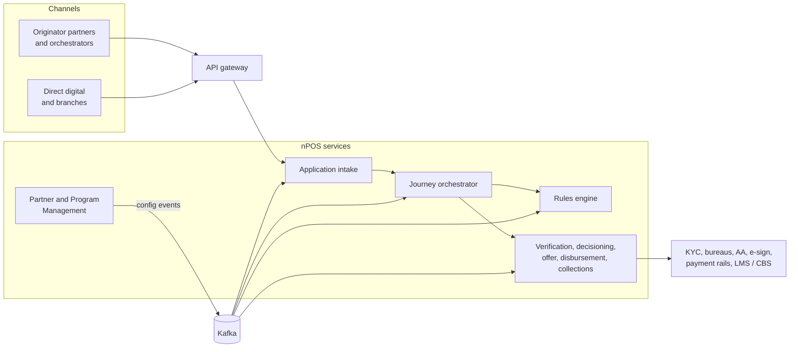

# Platform overview

## 1. Architecture principles

| Principle | What it means | Discovery finding it addresses |
|---|---|---|
| Configuration over code | A partner is set up as versioned data (programs, rule sets, journeys), never as new Python or Java files | O1, O2 |
| Database per service | Each service owns its MySQL schema. Others use its API or its events, never its tables | O3 |
| Synchronous edge, asynchronous core | Intake and decision answer quickly (or push a webhook). Everything after is event-driven | O9 |
| Idempotency and an explicit state machine | Every create or disburse call carries an idempotency key. One documented set of loan states | O9, duplicate loans |
| Transactional outbox | A state change and its event are saved in one transaction | Webhooks reporting things that did not happen |
| Multi-tenant, one codebase | Every record carries a tenant. The same images run hosted, or single-tenant at a bank | O10 |
| Zero-downtime releases | Rolling deploys on Kubernetes, backward-compatible migrations, configuration released as versioned packages | O4, O8 |
| Tested by default | Unit, integration (Testcontainers) and contract tests in CI; a regression pack per live partner configuration | O7 |

## 2. Technology stack

| Layer | Choice |
|---|---|
| Language and framework | Java 25 LTS, Spring Boot 4 (Spring Framework 7), Spring Cloud |
| Frontend | React 19, TypeScript, Vite, TanStack Query, React Hook Form + Zod, a component library (MUI or Ant Design) |
| Database | MySQL 8.4 LTS (InnoDB), Flyway migrations, one schema per service |
| Messaging | Apache Kafka 4 (KRaft), Debezium for outbox change capture, Schema Registry with Avro or Protobuf |
| Cache | Redis |
| API gateway | Spring Cloud Gateway (or Kong where a bank already standardises on it) |
| Identity and access | Keycloak (OAuth 2.0 / OIDC, MFA, federation), Spring Security, mutual TLS for partners |
| Workflow orchestration | Temporal or Camunda 8 (decided with Module 4) |
| Rules | DMN decision tables run by Apache KIE (Drools), behind our own rule-library UI (decided with Module 2) |
| Resilience | Resilience4j (circuit breakers, retries, bulkheads, rate limiters) |
| Documents | S3-compatible object storage (MinIO on premises) behind a document service |
| Secrets | HashiCorp Vault |
| Runtime | Kubernetes (OpenShift is common at banks), Helm, Argo CD |
| Observability | OpenTelemetry, Prometheus, Grafana, Loki, Tempo |
| Testing | JUnit 5, AssertJ, Testcontainers, Pact (contract tests), Playwright (UI), k6 (load) |
| Build and quality | Gradle or Maven, GitHub Actions or Jenkins, SonarQube, OWASP Dependency-Check, Trivy |

See [ADR-0001](../adr/0001-technology-baseline.md).

## 3. Modules

| # | Module (service) | SRS package | Owns |
|---|---|---|---|
| 0 | Platform foundation | UP-13 (part) | Gateway, Keycloak, shared libraries (tenant context, idempotency, outbox, audit), CI/CD, observability |
| 1 | **Partner and Program Management** | UP-01, UC-13.02 | Tenants, lenders, partners, programs, co-lending arrangements, DLG and limit definitions, commercials, partner credentials, go-live readiness |
| 2 | Credit Policy and Rules Engine | UP-02, UC-05.03 | Rule library, versioned rule sets, simulation, publishing, rule execution |
| 3 | Application Intake | UP-03 | Applications, idempotency, status, consents, bulk upload |
| 4 | Journey Orchestrator | Cross-cutting | Loan state machine, journeys per partner and program, retries, waiting for asynchronous events |
| 5 | Verification (KYC) | UP-04 | PAN, CKYC, Aadhaar, penny drop, dedupe, Account Aggregator, GST |
| 6 | Underwriting and Decisioning | UP-05 | Bureau, scoring, manual underwriting, deviations, pre-approved limits |
| 7 | Co-lending Allocation and Exposure | UC-05.04 | Lender selection, split, real-time limit utilisation |
| 8 | Offer, Sanction and Documentation | UP-06 | Offer, KFS, e-sign, e-stamp, documents, insurance, sanction letter |
| 9 | Disbursement and Boarding | UP-07 | Mandates, payouts, split funding, failure handling, LMS and core banking boarding |
| 10 | Post-disbursal Events | UP-08 | Cooling-off cancellation, returns, partial refunds, subvention |
| 11 | Collections, Ledger and Reconciliation | UP-09 | Escrow receipts, apportionment, reconciliation, DLG claims, partner settlement |
| 12 | Direct Assignment / Pool Buyout | UP-10 | Pool upload, screening, due diligence, pricing, monthly cash flows |
| 13 | Notifications and Webhooks | UP-11 | Signed partner webhooks, replay, borrower messages |
| 14 | Reporting, Audit and Compliance | UP-12 | Bureau reporting, returns, dashboards, audit trail, grievances |
| 15 | Integration adapters | Cross-cutting | One adapter per bureau, KYC vendor, payment rail and bank core system |
| UI | Back-office console and partner portal | All | React screens for each module |

## 4. Build order

0 → **1** → 2 → 3 + 4 → 5–9 (the checkout EMI path) → 13 → 10–12, 14

- **Module 1 first:** every other service reads its configuration.
- **Module 2 next:** the biggest business win (the BRE bottleneck).
- **Modules 3 and 4:** the first loan running end to end.

## 5. Context diagram

Module 1 publishes approved configuration. Every runtime service keeps a local
read model of it, so the loan journey never calls Module 1 synchronously on the
hot path (see [ADR-0007](../adr/0007-configuration-distribution.md)).
