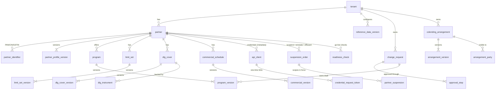

# Module 1: data model

Step 5 of the module. Status: **draft for review**.

The MySQL 8.4 schema for `partner-config-service`, implementing the domain
model and contracts. The schema is written as Flyway migrations in
[data-model/migrations/](data-model/migrations/). They move into the service's
`src/main/resources/db/migration` when implementation starts.

**Verified, not just written:**

- All 9 migrations apply cleanly on MySQL 8.4.11, both with the `mysql`
  client and with **Flyway 11** (31 tables, 4 triggers).
- [data-model/verify/constraint-tests.sh](data-model/verify/constraint-tests.sh)
  runs **39 behavioural tests**: each database-level rule is fed data it must
  accept and data it must reject. All 39 pass.

## 1. Key decisions

| Decision | Choice | Why |
|---|---|---|
| Content storage | Version terms in a JSON `content` column; lifecycle fields as real columns; queried content fields as stored generated columns | [ADR-0012](../../adr/0012-versioned-content-as-json-with-extracted-columns.md) |
| Primary keys | UUIDv7 as `BINARY(16)` | Time-ordered, so InnoDB inserts stay sequential; IDs can be generated by the service before insert; half the size of `CHAR(36)` |
| Tenancy | `tenant_id` on every business table; parents expose `UNIQUE (tenant_id, id)`; children use **composite foreign keys** `(tenant_id, parent_id)` | A row can never reference another tenant's row, even through a bug ([ADR-0003](../../adr/0003-multi-tenancy-model.md)) |
| Closed value sets | `VARCHAR` + `CHECK` | Readable values that map 1:1 to the API enums, without `ENUM`'s ordinal pitfalls. Adding a value means dropping and re-adding the CHECK, which copies the table: seconds at these sizes |
| Time | `DATETIME(6)` in UTC | Microsecond precision; no 2038 limit (unlike `TIMESTAMP`) |
| Money and rates | Paise as `BIGINT`; basis points as `INT` (inside JSON: integers) | No floating-point error |
| Foreign keys | Yes, within the schema, with no cascades | Integrity is cheap at this volume; deletes are never cascaded (history is kept) |
| One ACTIVE version | Unique index on a generated `active_parent_id` column (`CASE WHEN status='ACTIVE' THEN parent_id END`) | The database itself guarantees at most one version in force per aggregate |
| Optimistic locking | `row_version` column, exposed as the API's ETag | Two users cannot overwrite each other's draft |

## 2. Entity overview



Every `*_version` row belongs to exactly one change request (the FK is shown
for programs only, for readability).

Cross-cutting tables not shown: `audit_record`, `outbox_event`,
`idempotency_record`, `shedlock`, `business_id_sequence`, `config_package`,
`config_import`.

## 3. Table catalogue

| Migration | Table | Purpose | Approx. rows (FY29) |
|---|---|---|---|
| V1 | `tenant` | Northern Arc and bank tenants | 25 |
| V1 | `business_id_sequence` | Counters for PTR-, PRG-, CLA-, LST-, DLG-, COM-, CR- codes | 7 |
| V1 | `reference_data_version` | Checklists, product master, approval matrix, regulatory parameters… | ~2,000 |
| V2 | `change_request` | Maker-checker requests | ~10,000 / year |
| V2 | `approval_step` | Ordered approval steps and decisions | ~20,000 / year |
| V3 | `partner` | Partner identity and status | 200 per tenant |
| V3 | `partner_identifier` | PAN, CIN, LLPIN, GSTIN uniqueness | ~800 |
| V3 | `partner_profile_version` | Versioned UC-01.01 data | ~2,000 |
| V3 | `suspension_order`, `partner_suspension` | UC-01.07 requests and scopes in force | hundreds |
| V3 | `readiness_check` | Go-live checklist (8 rows per partner) | ~1,600 |
| V4 | `program`, `program_version` | UC-01.02 | 1,000 / 20,000 |
| V5 | `colending_arrangement`, `arrangement_version`, `arrangement_party` | UC-01.03 | hundreds |
| V6 | `limit_set`, `limit_set_version`, `dlg_cover`, `dlg_cover_version`, `dlg_instrument` | UC-01.04 | thousands |
| V7 | `commercial_schedule`, `commercial_version` | UC-01.06 | thousands |
| V8 | `api_client`, `credential_request_token` | UC-01.05 (no secrets) | ~500 |
| V9 | `audit_record` | Hash-chained audit log | ~200,000 / year |
| V9 | `outbox_event` | Transactional outbox (purged after publish) | small |
| V9 | `idempotency_record` | Idempotency keys (24 h) | small |
| V9 | `shedlock` | Single-runner scheduler lock | ~10 |
| V9 | `config_package`, `config_import` | ADR-0010 packages | hundreds |

The whole schema stays well under 10 GB for years. Size is not a design driver;
correctness and auditability are.

## 4. Where each rule is enforced

The domain layer enforces **every** rule on save and on approval (domain model
§5). The database adds a second line of defence for rules it can check
cheaply and reliably:

| Rule | Database enforcement | Verified by test |
|---|---|---|
| One partner per PAN/CIN/LLPIN/GSTIN (BR-01.01-01), released on rejection (BR-01.01-09) | `uk_partner_identifier_active` on a generated column that is NULL once released | ✓ |
| Business ID present after approval | `ck_partner_code_after_approval` | ✓ |
| At most one ACTIVE version per aggregate (G9) | `uk_*_active` on generated `active_parent_id` | ✓ |
| Gap-free, unique version numbers | `uk_*_version (parent_id, version)` + parent row lock (§5) | ✓ |
| effective_to after effective_from | `ck_*_period` | ✓ |
| No cross-tenant references (ADR-0003) | Composite FKs `(tenant_id, …)` | ✓ |
| Maker ≠ checker; one user one step (X1, BR-01.01-03) | Trigger `tr_approval_step_maker_checker` | ✓ |
| Return or reject needs a comment | `ck_approval_step_comment` | ✓ |
| Arrangement ACTIVE only after escrow and core verification (C5) | `ck_arrangement_version_verified` | ✓ |
| A lender cannot co-lend with itself | `ck_colending_distinct_lenders` | ✓ |
| DLG form allowed (BR-01.04-02) | `ck_dlg_cover_version_form` on extracted `dlg_form` | ✓ |
| BG and FD instruments have expiry; FD has lien status (L2) | `ck_dlg_instrument_expiry`, `ck_dlg_instrument_lien` | ✓ |
| Webhook URL is HTTPS | `ck_api_client_webhook_https` | ✓ |
| Audit log append-only and hash-chained (NFR-UP01-AU02) | Triggers reject UPDATE/DELETE and broken chains; app user granted SELECT, INSERT only | ✓ |
| A package is applied at most once; only if signed (ADR-0010) | `uk_config_import_applied`, `ck_config_import_signed` | ✓ |
| One outbox message per aggregate revision | `uk_outbox_event_revision` | ✓ |
| Shares total 100%, retention, DLG cap, rate policy, KFS mapping, … | **Domain layer only**: needs JSON content plus reference data | Unit tests (step 7) |

## 5. Concurrency

| Operation | Approach |
|---|---|
| Edit a draft | Optimistic: `UPDATE … WHERE id = ? AND row_version = ?`; 0 rows updated → `412 PRECONDITION_FAILED` |
| Create a new version | Lock the **parent** row (`SELECT … FROM program WHERE id = ? FOR UPDATE`), read `latest_version`, insert `latest_version + 1`, update the parent, all in one transaction. Version numbers stay gap-free, and two drafts cannot get the same number |
| Activate a version (approval or scheduler) | Same parent lock; mark the old ACTIVE `SUPERSEDED` (set `effective_to`), mark the new one `ACTIVE`, increment `snapshot_revision`, write the outbox row and audit record, then commit. The unique active index rejects any interleaving that slipped past the lock |
| Assign a business ID | `SELECT next_value FROM business_id_sequence WHERE prefix = ? FOR UPDATE` inside the approval transaction (short lock; approvals are rare) |
| Scheduled jobs | ShedLock row per job, so activation and expiry jobs run on one replica at a time. Jobs query `ix_*_due (status, effective_from)` |
| Audit chain | `uk_audit_record_chain (aggregate_type, aggregate_id, aggregate_seq)`: two concurrent writers cannot fork a chain; the loser retries with the next sequence |

## 6. Query patterns and their indexes

| Query | Index |
|---|---|
| Partners by status, by name search | `ix_partner_status`, `ix_partner_name` |
| Duplicate check by PAN, CIN, GSTIN (≤ 1 s, NFR-UP01-P02) | `ix_partner_identifier_lookup` |
| Work list: steps awaiting my role in my tenant | `ix_approval_step_worklist (step_tenant_id, role, status)` |
| Overdue approvals (SLA) | `ix_change_request_status_due` |
| Versions due for activation | `ix_*_due (status, effective_from)` on every version table |
| Programs using a rule set (gap G-3) | `ix_program_version_rule_set` (EXPLAIN-verified) |
| Programs affected by an arrangement, limit set or DLG change | `ix_program_version_arrangement`, `_limit_set`, `_dlg` |
| Point-in-time version (`asOf`) | `uk_*_version (parent_id, version)`, filtered on effective_from / effective_to (≤ 20 versions per parent) |
| Arrangements visible to a co-lender tenant | `ix_arrangement_party_tenant` |
| Instruments, secrets and certificates expiring | `ix_dlg_instrument_expiry`, `ix_api_client_secret_expiry`, `ix_api_client_cert_expiry` |
| Audit by aggregate, by actor, by time | `uk_audit_record_chain`, `ix_audit_record_actor`, `ix_audit_record_tenant_time` |

## 7. Outbox and Debezium

`outbox_event` is shaped for Debezium's outbox event router:

| Router setting | Column |
|---|---|
| `table.field.event.id` | `id` |
| `table.field.event.key` | `aggregate_id` |
| `table.field.event.payload` | `payload` |
| `route.by.field` (topic) | `topic` |
| `table.fields.additional.placement` | `event_type:header:ce_type`, `tenant_id:header:ce_tenantid`, plus `headers` expanded to `ce_*` |

A purge job deletes outbox rows older than one hour. Debezium reads the
binlog, so deleting a row does not lose its event. The binlog must use
`binlog_format=ROW` and `binlog_row_image=FULL` (MySQL 8.4 defaults).

## 8. Security

| Concern | Approach |
|---|---|
| Database users | `pc_migrator` (DDL, used only by Flyway at deploy time); `pc_app` (DML only; on `audit_record` **SELECT and INSERT only**); `pc_debezium` (REPLICATION SLAVE, REPLICATION CLIENT, SELECT on `outbox_event`); `pc_readonly` for support |
| Encryption at rest | InnoDB tablespace encryption with a keyring component (Vault-backed where available), and binlog and redo/undo encryption on (NFR-UP01-D02) |
| Encryption in transit | `require_secure_transport=ON`; TLS 1.2+ for all clients (NFR-UP01-D03) |
| PII | Partner contacts and director details live in `partner_profile_version.content`; masked by role in the API (NFR-UP01-D01). Field-level encryption of contact data is an open option (O-2 below) |
| Secrets | None stored. Credential tokens are stored as SHA-256 hashes; client secrets and signing keys stay in Keycloak and Vault (ADR-0009) |
| Non-production data | Masked or synthetic only (NFR-UP01-D05) |

Grants are applied by the platform's database provisioning (Module 0), not by
Flyway, so the migration user never needs `GRANT` rights.

## 9. Retention and archival

- Nothing in this schema is deleted by the application except `outbox_event`
  (after publish), `idempotency_record` (after 24 h) and expired
  `credential_request_token` rows.
- Partner records, versions, change requests and audit records are kept for at
  least **8 years after offboarding** (NFR-UP01-D06, AU05). A yearly job
  exports records past retention to the archive and deletes them. The
  migrator user runs it, because the app user cannot delete audit rows.
- Volumes are small, so partitioning is not needed. `audit_record` can be
  range-partitioned by year later if archival needs it.

## 10. Migration rules (for every future change)

These follow ADR-0011's zero-downtime, N/N-1 rule:

1. **Expand, then contract.** Add new columns or tables first (nullable or with
   defaults); deploy code that writes both; backfill; deploy code that reads
   the new shape; drop the old one in a later release.
2. Never rename or drop a column in the same release that stops using it.
3. New queryable content fields are added as generated columns plus indexes.
   A `VIRTUAL` generated column with a secondary index is added in place; a
   `STORED` one rebuilds the table (seconds at these sizes, but schedule it).
4. Every migration runs in CI against MySQL 8.4 via Testcontainers, followed by
   `constraint-tests.sh`.
5. Migrations are immutable once released. A fix is a new migration.

## 11. How to run the verification locally

```bash
docker run -d --name npos-mysql -e MYSQL_ROOT_PASSWORD=root -e MYSQL_DATABASE=partner_config mysql:8.4
cd docs/modules/01-partner-program/data-model
for f in $(ls migrations/*.sql | sort -V); do docker exec -i npos-mysql mysql -uroot -proot partner_config < "$f"; done
./verify/constraint-tests.sh          # expect: passed: 39  failed: 0
```

## 12. Open items

| # | Item | Proposal |
|---|---|---|
| O-1 | `copied_from_version` is a version **number** on most tables but a version **ID** on `program_version` (a clone can come from another program) | Keep; the program case genuinely crosses aggregates |
| O-2 | Field-level encryption for partner contact PII inside `content` | Decide with Northern Arc security; tablespace encryption plus API masking may be enough for business-contact data |
| O-3 | Reference data is held per tenant, so national regulatory values are duplicated per tenant | Keep for now (a bank may set stricter internal values); revisit if tenants grow |
| O-4 | `readiness_check` duplicates information derivable from other tables | Intentional: it records attestations and gives the UI a single read; recomputed on every relevant change |
