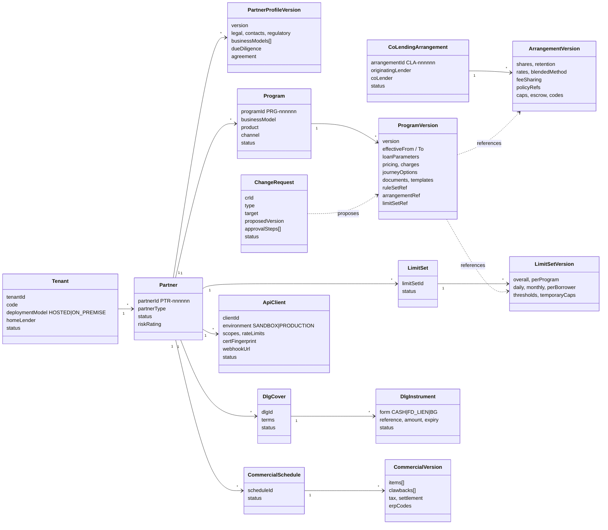
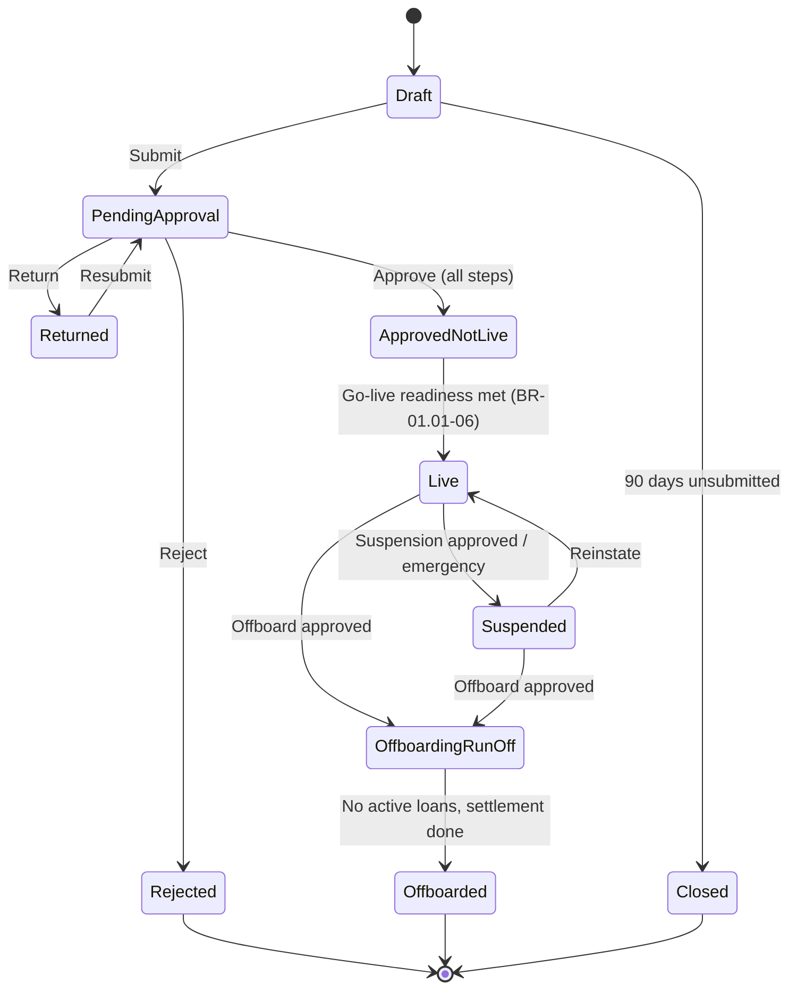
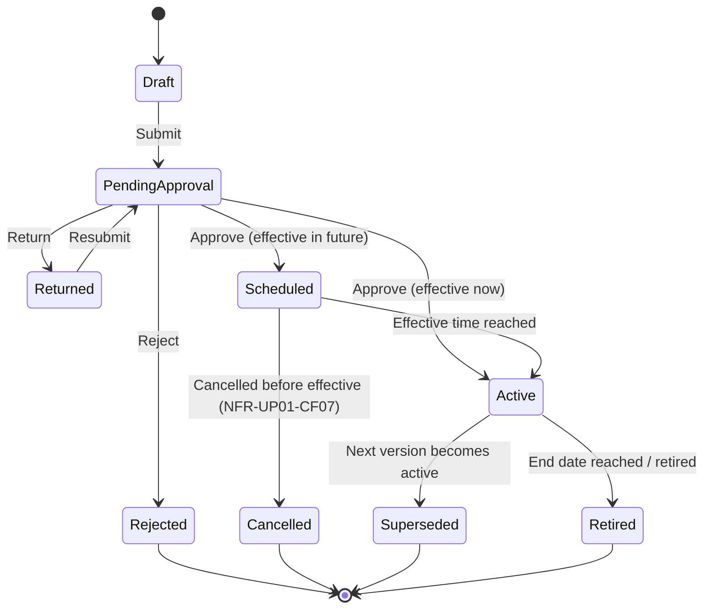
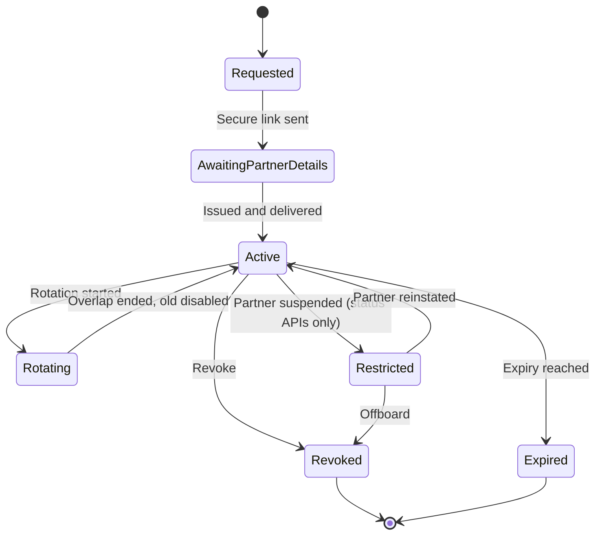
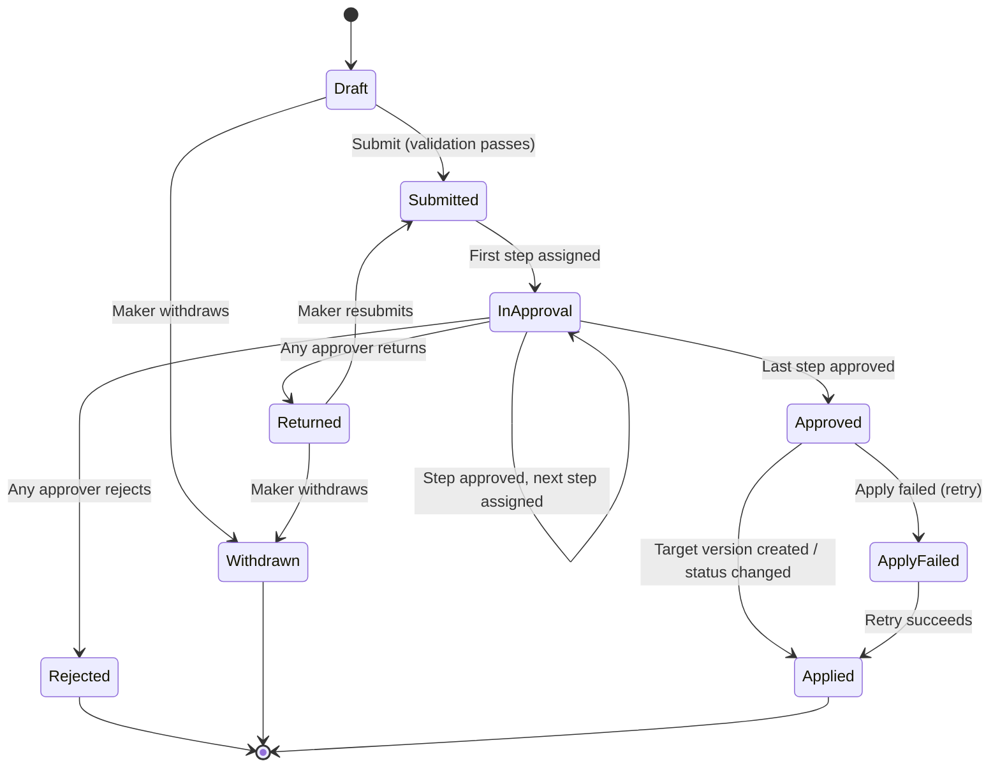

# Module 1: domain model

Step 2 of the module. Status: **draft for review**.

This document defines the business objects of Partner and Program Management,
their lifecycles and the rules they must always obey. It is technology-neutral:
the MySQL schema and APIs come in later steps and must follow this model.

## 1. Core idea: identity, versions and change requests

Almost everything in this module follows one pattern:

- An **identity** object that lives for years and carries a lifecycle status
  (for example a Partner, a Program, a Co-lending Arrangement).
- A series of **immutable, effective-dated versions** holding the actual terms
  (ProgramVersion v1, v2, v3…). A loan always records which version it used.
- A **change request** that proposes a new version (or a status change), goes
  through maker-checker approval, and on approval creates the version.

Users never edit live data. They draft a change, someone else approves it, and
the approved version takes effect at its effective time. Rollback is just
another approved change that re-activates the previous terms.

See [ADR-0004](../../adr/0004-immutable-effective-dated-versions.md) and
[ADR-0005](../../adr/0005-generic-maker-checker-change-requests.md).

## 2. Aggregates at a glance

| Aggregate | Owns | Use case | Approved by |
|---|---|---|---|
| **Tenant** | Isolation boundary, deployment model, home lender, branding, tenant settings | UC-13.02 | Platform admin |
| **Partner** | Legal entity, status, profile versions, due diligence, agreement, documents (references) | UC-01.01, UC-01.07 | Compliance (+ Head of Compliance if high risk) |
| **Program** | Product offering for one business model × product × channel; versions with terms | UC-01.02 | Credit policy manager (+ Credit approver for exceptions) |
| **CoLendingArrangement** | Two-lender agreement and its versions | UC-01.03 | Co-lender user, then system verification |
| **LimitSet** | Exposure limit definitions and versions | UC-01.04 | Compliance (decreases: Compliance only) |
| **DlgCover** | DLG terms and the instrument backing them | UC-01.04 | Finance (instrument), Compliance |
| **CommercialSchedule** | Fees, subvention, clawbacks, tax and settlement terms; versions | UC-01.06 | Finance |
| **ApiClient** | One partner credential per environment (no secrets stored) | UC-01.05 | Go-live readiness for production |
| **ChangeRequest** | A proposed change, its approval steps and decisions | All | Per approval matrix |
| **SuspensionOrder** | Scope, reason, effective time, in-flight handling, emergency flag | UC-01.07 | Compliance |
| **ReferenceData**, **RegulatoryParameter** | Partner types, checklists, product master, charge types, reason codes, approval matrix; DLG cap, retention, cooling-off, rate policy | Supporting | Compliance / Risk |

Supporting read models (derived, not edited): **GoLiveReadiness** per partner,
**ConfigurationSnapshot** published to other services, **point-in-time view**.

## 3. Identity and money conventions

| Concern | Convention |
|---|---|
| Technical keys | UUIDv7 (time-ordered, safe to generate in any service) |
| Business IDs | Human-readable, generated on approval, never reused: `PTR-000123`, `PRG-000456`, `CLA-000078`, `LMS-…` |
| Version numbers | Integer per identity, starting at 1, gap-free |
| Amounts | Integer **paise** (`BIGINT`). Never floating point |
| Rates and percentages | Integer **basis points** (1850 = 18.50%; 8000 = 80%) |
| Dates and times | Stored in UTC; effective times entered and shown in IST |
| Tenant | Every aggregate carries `tenantId`; no query runs without it (ADR-0003) |

## 4. Lifecycles

### 4.1 Partner

From UC-01.01 and UC-01.07.

Only **Live** partners (for programs that are not suspended) may submit new
applications. **Suspended** and **OffboardingRunOff** partners may still use
status and servicing APIs.

### 4.2 Versioned configuration (programs, arrangements, limit sets, commercials, partner profile)

All versioned configuration shares one version lifecycle. Each type adds
only its own extra states.

Extra states by type:

| Type | Extra states | Source |
|---|---|---|
| CoLendingArrangement | `PendingVerification` between approval and active (escrow and core-system checks); `Suspended`; `Expired` at agreement end | UC-01.03 |
| DlgInstrument | `Recorded → Verified / NotVerified → Active → ExpiringSoon → Expired`, `TopUpRequired`, `Released` | UC-01.04 |
| Program | `Retired` blocks new applications; in-flight applications finish on their version | UC-01.02 A6 |

**Deviation from UC-01.02 for review:** the use case has `Approved → InSandbox
→ Live` states on the program. In this design, moving between environments is
done with configuration packages ([ADR-0010](../../adr/0010-configuration-packages.md)),
so a version is simply `Active` or not *in each environment*. Production
use is additionally gated by the partner's go-live readiness.

### 4.3 API client (credential)

From UC-01.05.

`Restricted` is added to support UC-01.07 step 9 (status and servicing APIs only).

### 4.4 Change request

Approval steps come from the **approval matrix** (reference data) by change
type and conditions. Examples:

| Change type | Condition | Steps |
|---|---|---|
| Onboard partner | risk rating Low/Medium | Compliance officer |
| Onboard partner | risk rating High | Compliance officer → Head of Compliance (BR-01.01-05) |
| Program version | within rate policy | Credit policy manager |
| Program version | policy exception flagged | Credit policy manager + Credit approver (UC-01.02 A3) |
| Arrangement version | — | Co-lender user (of the co-lender's tenant) |
| Limit set increase / DLG | DLG present | Finance (instrument) → Compliance |
| Limit set decrease | — | Compliance only (UC-01.04 A4) |
| Commercials | — | Finance |
| Suspend / reinstate / offboard | — | Compliance |
| Emergency suspension | started by Compliance | Applied immediately; approval recorded after (UC-01.07 A1) |
| Rollback to previous version | — | Same steps as the original change |

## 5. Invariants (rules that must always hold)

Enforced in the domain layer, on save **and** on approval, and tested.

### Partner
- **P1** One partner per legal entity: PAN, CIN/LLPIN and GSTIN each unique
  within the tenant (BR-01.01-01).
- **P2** Mandatory fields and documents depend on the partner type's checklist
  (BR-01.01-02). Every checklist document has a DMS reference before submission.
- **P3** Only RBI-regulated lenders may be approved for co-lending or as DA
  sellers, with certificate of registration details (BR-01.01-04).
- **P4** LSP and DLA partners must have a grievance officer with phone and email
  (BR-01.01-07).
- **P5** An expired due-diligence assessment (12 months) blocks new programs
  (BR-01.01-08).
- **P6** A rejected partner is never reopened; a new case references it
  (BR-01.01-09).
- **P7** A partner becomes Live only when go-live readiness is met
  (BR-01.01-06, see section 6).

### Program
- **G1** min ≤ max for amounts and tenures, within the product master
  (UC-01.02 data rules).
- **G2** The rate band and every risk-grade rate sit within the interest rate
  policy for the product, unless flagged as a policy exception (BR-01.02-01).
- **G3** Every charge maps to a KFS line; no charge outside the KFS
  (BR-01.02-02).
- **G4** Cooling-off days ≥ the regulatory minimum (BR-01.02-03).
- **G5** Merchant disbursement and subvention only for purchase-finance
  products (BR-01.02-04).
- **G6** Only business models the partner is approved for (BR-01.02-07).
- **G7** A program version cannot become Active in production without a
  published rule-set version (BR-01.02-06), an Active arrangement if
  co-lending, and an Active limit set if the agreement requires one.
- **G8** Fees to an LSP are never configured as borrower charges
  (BR-01.06-01, NFR-UP01-R05).
- **G9** Effective periods of a program's versions never overlap; at any
  instant at most one version is in force (BR-01.02-05).

### Co-lending arrangement
- **C1** Shares total 100%; each lender's share ≥ its minimum retention and the
  regulatory minimum (BR-01.03-01).
- **C2** Both lenders are RBI-regulated and active; the co-lender is an active
  tenant or regulated partner.
- **C3** daily cap ≤ monthly cap ≤ total limit (BR-01.03-06).
- **C4** Every KFS charge is assigned to a lender in the fee-sharing rules.
- **C5** Becomes Active only after escrow and co-lender core verification.
- **C6** A new version applies only to loans allocated after its effective
  time (BR-01.03-04).

### DLG and limits
- **L1** Total DLG for a partner's covered portfolio ≤ the regulatory cap
  (BR-01.04-01).
- **L2** DLG form is cash deposit, FD with lien, or bank guarantee
  (BR-01.04-02); instrument amount equals the DLG amount; expiry ≥ DLG
  validity end; FD lien status is Marked.
- **L3** Sum of per-program limits ≤ overall limit; daily ≤ monthly;
  per-borrower maximum ≤ the program's maximum amount.
- **L4** Temporary caps always have an end date (BR-01.04-05).
- **L5** An expired instrument stops new disbursements for covered programs
  (BR-01.04-04). Module 1 publishes the change; Module 7 enforces it.

### Credentials
- **K1** Scopes limited to the APIs of the partner's approved programs
  (BR-01.05-01).
- **K2** Production credentials only when all other go-live checks are met
  (BR-01.05-04).
- **K3** Secrets are never stored or logged by Module 1 (ADR-0009). Sandbox
  and production credentials always differ.
- **K4** Rotation overlap ≤ 7 days; secret ≤ 180 days; certificate ≤ 1 year
  (BR-01.05-02/03, configurable).

### Commercials
- **M1** No overlapping items of the same type for the same program and period.
- **M2** Every fee payable to a partner traces to an agreement clause
  (BR-01.06-02).
- **M3** A new version applies to loans disbursed on or after its effective
  date (BR-01.06-03).

### Cross-cutting
- **X1** Maker ≠ checker on every change request; the same user cannot approve
  two steps of one request (BR-01.01-03, NFR-UP01-S04).
- **X2** Every state change and approval writes an audit record with before and
  after values, in the same transaction (NFR-UP01-AU01).
- **X3** Data from one tenant is never visible to another, except an
  arrangement's terms to its two lender parties (ADR-0003).

## 6. Go-live readiness

A partner moves from `ApprovedNotLive` to `Live` automatically when every check
passes. Each check is a row in the readiness model, so the UI can show what is
outstanding.

| Check | Source | Until the owning module exists |
|---|---|---|
| Partner approved | Module 1 | — |
| ≥ 1 program version approved, with rule set linked | Module 1 (+ Module 2) | Rule-set reference validated by format |
| DLG and limits active where the agreement requires them | Module 1 | — |
| Co-lending arrangement active where applicable | Module 1 | — |
| Production credentials issued | Module 1 (ApiClient) | — |
| Contract tests passed in sandbox | Test harness (event) | Manual attestation by Platform admin |
| LSP / DLA disclosure published | Module 14 (event) | Manual attestation by Compliance |
| Due diligence not expired | Module 1 | — |

## 7. Domain events

Published via the transactional outbox ([ADR-0002](../../adr/0002-database-per-service-and-events.md)).
Consumers build their read models from these ([ADR-0007](../../adr/0007-configuration-distribution.md)).

| Event | When | Main consumers |
|---|---|---|
| `TenantProvisioned` | Tenant ready | All services |
| `PartnerApproved` | Approved – not live | Credentials, reporting |
| `PartnerWentLive` | Readiness met | Intake, gateway, notifications |
| `PartnerSuspended` / `PartnerReinstated` | Suspension effective / lifted (scoped) | Intake, gateway, orchestrator, notifications (**priority**) |
| `PartnerOffboardingStarted` / `PartnerOffboarded` | Run-off begins / completes | Settlement, DLG, disclosures |
| `ProgramVersionActivated` / `ProgramVersionRetired` | Version in force / retired | Intake, orchestrator, decisioning, offer |
| `ArrangementVersionActivated` / `ArrangementSuspended` | Arrangement in force / stopped | Allocation, disbursement, collections |
| `LimitSetVersionActivated` | New limits in force | Exposure (Module 7) |
| `DlgInstrumentStatusChanged` | Verified, expiring, expired, released | Exposure, DLG claims |
| `CommercialVersionActivated` | New commercials in force | Settlement |
| `ApiClientIssued` / `ApiClientRestricted` / `ApiClientRevoked` | Credential changes | Gateway (**priority**), notifications |
| `RegulatoryParameterChanged` | DLG cap, retention, cooling-off changed | Impact report, all validators |

Every event carries: `eventId`, `tenantId`, aggregate ID, version, effective
time, the **full snapshot** of the new state (not only a delta), and a
correlation ID linking it to the change request.

## 8. What changes for Northern Arc's team

| Today | With this model |
|---|---|
| Copy the previous partner's Python, Java and workflow stages | Clone the partner's programs as a draft and change parameters |
| SQL release document approved by other partners' owners | Change request approved by the right role; other partners are untouched because their versions do not change |
| Release needs downtime for all partners | A new version activates at its effective time with no deployment |
| "Which rules does FatakPay have?" needs a developer | Program version and linked rule set are visible in the UI, with history |
