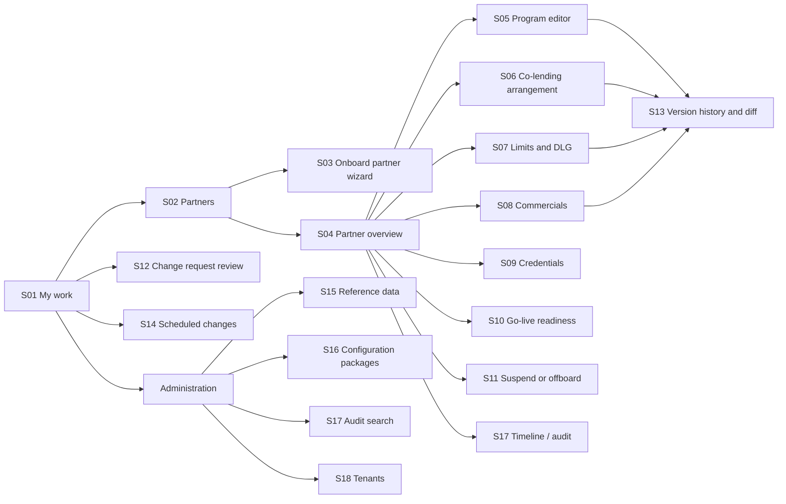

# Module 1: screens

Step 6 of the module. Status: **draft for review**.

The back-office screens for Partner and Program Management, built in the React
back-office console. For each screen this document lists who uses it, what it
shows, what users can do, and which API operations it calls
([contracts](contracts/README.md)). Visual design (colours, typography) is
left to the design system. This document fixes **content, behaviour and access**.

## 1. Design principles

| Principle | What it means on screen | Requirement |
|---|---|---|
| Work list first | Users land on *My work*: what waits for their decision, their drafts, what is overdue | NFR-UP01-U03 |
| One editing pattern everywhere | Every configurable thing uses the same draft → validate → submit → approve flow, with the same components | ADR-0004, ADR-0005 |
| Status always visible | Every version shows a status badge (Draft, Pending, Scheduled, Active, Superseded…) and its effective dates | ADR-0004 |
| All problems at once | Validation lists every missing field and broken rule together, each with the rule ID and how to fix it | NFR-UP01-U01, U06 |
| Approvers see the change, not the form | Approval screens open on a side-by-side diff against the version in force | NFR-UP01-U02 |
| Clone before create | Every "new" action offers "copy from an existing one" | Discovery O2, NFR-UP01-CF01 |
| Least exposure | PII masked by role; secrets never shown; actions hidden *and* refused server-side when the role lacks them | NFR-UP01-D01, S02 |
| Never lose work | Drafts auto-save every 2 minutes; a stale draft warns instead of overwriting (ETag) | NFR-UP01-S10 |
| Accessible | WCAG 2.1 AA: keyboard navigation, labels on every field, contrast | NFR-UP01-U05 |
| Fast | Screens load and save within 2 s (p95) | NFR-UP01-P01 |

## 2. Navigation map



Partner-facing: **P01 Credential details** (opened from a one-time link, outside the console).

## 3. Screen catalogue

| ID | Screen | Main users | Use cases |
|---|---|---|---|
| S01 | My work | All internal roles, co-lender users | All (work lists) |
| S02 | Partners (list and search) | Partner manager, Compliance, Finance, Credit policy, Auditor | UC-01.01 |
| S03 | Onboard partner (wizard) | Partner manager | UC-01.01 |
| S04 | Partner overview | Partner manager, Compliance, Finance | UC-01.01–01.07 |
| S05 | Program editor | Partner manager, Credit policy manager | UC-01.02 |
| S06 | Co-lending arrangement | Partner manager, Credit policy manager, Co-lender user | UC-01.03 |
| S07 | Limits and DLG | Partner manager, Finance, Compliance | UC-01.04 |
| S08 | Commercials | Partner manager, Finance | UC-01.06 |
| S09 | Credentials | Platform administrator | UC-01.05 |
| S10 | Go-live readiness | Partner manager, Compliance, Platform administrator | BR-01.01-06 |
| S11 | Suspend or offboard | Partner manager, Compliance | UC-01.07 |
| S12 | Change request review | All approvers | All (ADR-0005) |
| S13 | Version history and diff | All internal roles | ADR-0004 |
| S14 | Scheduled changes | Partner manager, Compliance, Credit policy, Finance | NFR-UP01-CF07 |
| S15 | Reference data | Compliance, Credit policy, Platform administrator | Supporting |
| S16 | Configuration packages | Platform administrator | ADR-0010 |
| S17 | Audit search and partner timeline | Compliance, Auditor, Platform administrator | NFR-UP01-AU01, O04 |
| S18 | Tenants | Platform administrator | UC-13.02 |
| P01 | Credential details (partner) | Partner technical contact | UC-01.05 step 4 |

## 4. Shared components

Built once, used on every screen. They are the main reason a new configurable
object costs little UI work.

| Component | What it does |
|---|---|
| `VersionStatusBadge` | Status + effective dates, e.g. *Scheduled · from 20 Oct 2026 00:00 IST* |
| `DraftToolbar` | Save (auto-save indicator), Validate, Submit for approval, Withdraw; disabled states explain why |
| `ValidationPanel` | Lists every violation with rule ID and fix; clicking one jumps to the field |
| `ChangeRequestPanel` | CR code, maker, approval steps with who/when/comment, current step, SLA due |
| `DecisionBar` | Approve / Return / Reject with mandatory comment for return and reject; hidden for the maker |
| `VersionDiff` | Side-by-side or inline diff of two versions, grouped by section, changed fields highlighted |
| `CloneDialog` | Pick a source (any partner's program or arrangement in the tenant) and version |
| `EffectiveDateTimePicker` | Enters IST, shows UTC on hover; blocks past times on submit |
| `MoneyInput` / `RateInput` | ₹ with Indian digit grouping, stored as paise / % stored as basis points |
| `DocumentChecklist` | Required documents per partner type; upload via pre-signed URL; progress; retry on failure |
| `MaskedField` | Shows `XXXXX1234K` unless the role may see PII; reveal is audited |
| `AuditTimeline` | Chronological list of who did what, with before/after for changes |
| `ImpactSummary` | Counts from other modules (in-flight, sanctioned, active loans, DLG balance); shows "not available yet" when a module is absent |

## 5. Screen specifications

### S01 My work

**Purpose:** the landing page. Everything waiting for the user.

| Section | Content | API |
|---|---|---|
| Awaiting my decision | Change requests whose current step is my role in my tenant, oldest due first, overdue highlighted | `listChangeRequests(view=AWAITING_MY_DECISION)` |
| My drafts | Drafts and returned requests I own, with last saved time | `listChangeRequests(view=MY_DRAFTS)` |
| Submitted by me | Status of my requests in approval | `listChangeRequests(view=MY_SUBMITTED)` |
| Coming up | Approved changes taking effect in the next 7 days | `listScheduledChanges` |
| Alerts | DLG instruments, secrets and certificates expiring; due diligence expiring (role-filtered) | partner and credential reads |

Filters: type, partner, overdue. A co-lender user sees only their bank's requests.

### S02 Partners

List with search by name, PTR code, PAN, CIN or GSTIN; filters by status and
type; columns: partner, type, status badge, programs live, risk rating, last
change. Action: **Onboard partner** (Partner manager). API: `listPartners`.

### S03 Onboard partner (wizard)

Steps follow UC-01.01:

1. **Partner type**: checklist and form sections adapt to the type.
2. **Legal details**: PAN, CIN/LLPIN, GSTIN with format checks; the duplicate check runs on blur (`checkPartnerDuplicates`, ≤ 1 s). A match offers *Open existing partner* (alt. flow A1).
3. **Contacts**: grievance officer required for LSP/DLA (BR-01.01-07).
4. **Regulatory status**: hides RBI fields for unregulated partners and blocks co-lending/DA (A3).
5. **Scope**: business models, products, channels, expected volume.
6. **Documents**: `DocumentChecklist` (pre-signed upload, retry on DMS failure, E1).
7. **Due diligence**: risk rating (High warns that a second approval is needed, A4), findings, assessment expiry dates.
8. **Agreement**: upload and key terms.
9. **Review and submit**: summary, `ValidationPanel`, *Submit for approval*.

API: `createPartner`, `updatePartnerProfileDraft` (auto-save, If-Match),
`requestPartnerDocumentUpload`, `validatePartnerProfileDraft`,
`submitChangeRequest`. Users can leave and resume at any step (A2).

### S04 Partner overview

Header: name, PTR code, type, status badge, risk rating, active suspensions,
readiness progress (e.g. *6 of 8 checks passed*).

Tabs:

| Tab | Content | Actions (role) |
|---|---|---|
| Profile | Active profile version, read-only, PII masked by role | New version (Partner manager) |
| Programs | Programs with active and scheduled versions, rule set linked | New program / clone (Partner manager) → S05 |
| Co-lending | Arrangements involving this partner | New arrangement → S06 |
| Limits and DLG | Active limits, temporary caps, DLG cover and instrument status, utilisation (from Module 7 when available) | Change limits → S07 |
| Commercials | Active items, clawbacks, settlement terms | Change → S08 |
| Credentials | Sandbox and production clients (metadata only) | Manage → S09 (Platform admin) |
| Readiness | Checklist | → S10 |
| Timeline | Everything that happened, newest first | → S17 |

Header action: **Suspend / reinstate / offboard** → S11 (Partner manager, Compliance).

### S05 Program editor

Sections follow UC-01.02: scope (business model, product, channel, name);
loan parameters; pricing (rate band and risk-grade grid); charges (each mapped
to a KFS line); journey (KYC methods, AA, e-sign, e-stamp, mandate,
disbursement mode, insurance); documents; templates and cooling-off; links
(rule set, arrangement, limit set, DLG cover).

```
┌ Program: FatakPay Personal Loan – App  (PRG on approval) [Draft v1] CR-000117┐
│ Sections        │ Pricing                                                    │
│ ✓ Scope         │ Rate type   (•) Fixed  ( ) Floating                        │
│ ✓ Loan params   │ Rate band   [ 24.00 ]% to [ 30.00 ]%   ⚠ BR-01.02-01      │
│ ● Pricing       │ Risk grade  A [24.00]%  B [27.00]%  C [30.00]%             │
│ ○ Charges       │ Subvention  [ ] allowed (purchase finance only)            │
│ ○ Journey       │                                                            │
│ ○ Templates     │ ──────────────────────────────────────────────────────── │
│ ○ Links         │ Validation: 1 problem                                      │
│                 │  • RATE_OUTSIDE_POLICY  Max 30.00% is above policy 28.00%. │
│                 │    Lower the band or flag a policy exception.  [Go to field]│
│ [Saved 10:42]   │ [Validate + sample KFS]   [Submit for approval]            │
└─────────────────┴────────────────────────────────────────────────────────────┘
```

- **Validate + sample KFS** shows the generated KFS and repayment schedule (`validateProgramDraft`, ≤ 5 s).
- The credit policy manager links the rule set while the version is pending their approval (a picker of published rule sets; until Module 2 exists, the rule set ID is entered and format-checked).
- **Policy exception** toggle with reason adds the Credit approver step (A3).
- Live programs: **New version** (copy of the active one) and **Retire** (end date, A6).

API: `createProgram` (with `cloneFrom`), `createProgramDraft`,
`updateProgramDraft`, `validateProgramDraft`, `retireProgram`.

### S06 Co-lending arrangement

Parties (originating lender, co-lender, originator), agreement, products,
origination model and review window, shares and minimum retention (live
total and retention check), rates and blended-rate preview, fee sharing per
charge, both lenders' rule sets, limits, escrow, apportionment, co-lender codes.

After co-lender approval: a **verification panel** shows escrow confirmation
and core-system acknowledgement, with *Retry verification* (E1, E2).

Co-lender users see this screen read-only for their bank's arrangements,
with the approval `DecisionBar` when it is their step, and **Suspend** (A4).

API: `createArrangement`, `updateArrangementDraft`,
`validateArrangementDraft`, `retryArrangementVerification`, `suspendArrangement`.

### S07 Limits and DLG

- **Limits**: overall, per program, daily and monthly caps, per-borrower maximum, alert thresholds; **temporary caps** with mandatory end time (A3).
- **DLG cover**: form, amount or % of portfolio with a live check against the regulatory cap, covered programs, validity, invocation terms.
- **Instrument** (Finance): record the instrument with evidence upload, then **Verified / Not verified** with reason. This is the Finance approval step, so the maker cannot do it.

API: `createLimitSet`, `createLimitSetDraft`, `updateLimitSetDraft`,
`createDlgCover`, `updateDlgCoverDraft`, `recordDlgInstrument`, `verifyDlgInstrument`.

### S08 Commercials

Item table (type, direction, basis, rate or amount, programs, agreement
clause), clawbacks, tax, settlement and invoicing, ERP codes (looked up; a
warning and *Request codes from Finance* when missing, E1). Future effective
date required for changes (A1). API: `createCommercialSchedule`,
`createCommercialDraft`, `updateCommercialDraft`.

### S09 Credentials

Per environment: status, client ID, scopes, rate limits **per second and per
day**, certificate fingerprint and expiry, IP allow-list, webhook URL and
verification state, secret expiry.

Actions (Platform admin): *Request credentials* (production disabled with the
list of unmet readiness checks, BR-01.05-04), *Edit scopes / limits / IPs /
webhook*, *Rotate* (overlap ≤ 7 days), *Revoke* (reason; also Compliance).
Secrets never appear on this screen.

API: `requestApiClient`, `updateApiClient`, `rotateApiClient`, `revokeApiClient`.

### S10 Go-live readiness

The eight checks with status, source and detail. Attestation form for
*Contract tests passed* (Platform admin) and *Disclosure published*
(Compliance), with evidence link. A banner announces when the partner goes
live. API: `getReadiness`, `attestReadinessCheck`.

### S11 Suspend or offboard

1. Choose action and scope (whole partner, programs, products, channels).
2. `ImpactSummary` (in-flight by stage, sanctioned not disbursed, active loans, DLG balance; ≤ 5 s).
3. In-flight handling, reason, effective time (immediate or scheduled).
4. **Emergency** toggle (Compliance only): a red confirmation explains that it applies at once and approval is recorded afterwards (A1).

API: `getPartnerImpact`, `createSuspensionOrder`.

### S12 Change request review

The approver's main screen.

```
┌ CR-000117 · Program version · FatakPay Personal Loan – App v2 ─ due 14 Oct ┐
│ Maker: priya (Partner manager) · submitted 13 Oct 11:02                     │
│ Steps: ① Credit policy manager — PENDING (you)   ② Credit approver — WAITING│
├──────────────────────────────── Changes (v1 active → v2) ──────────────────┤
│ Pricing › rate band          24.00–30.00%   →   24.00–28.00%                 │
│ Charges › processing fee     2.00%          →   1.75%                        │
│ Effective from               —              →   01 Nov 2026 00:00 IST        │
├──────────────────────────────── Checks ─────────────────────────────────────┤
│ ✓ Validation passed   ✓ Sample KFS [view]   ✓ Rule set RS-PL-STD v7 linked  │
├──────────────────────────────────────────────────────────────────────────────┤
│ Comment [________________________________]                                   │
│ [Approve]   [Return to maker]   [Reject]                                     │
└──────────────────────────────────────────────────────────────────────────────┘
```

- Opens on the `VersionDiff` against the version in force; a toggle shows the full version.
- The `DecisionBar` is hidden for the maker, and for anyone who already decided a step of this request (the server refuses either way).
- Regulatory parameter changes show the attached impact report (NFR-UP01-R07).

API: `getChangeRequest`, version reads and diff, `decideChangeRequest`.

### S13 Version history and diff

All versions of an aggregate with status, effective period, maker, approvers.
Pick any two to compare. **Roll back to this version** creates a rollback
draft (same approvals, ADR-0004). API: version list, `…/diff/…`, `NewDraft(purpose=ROLLBACK)`.

### S14 Scheduled changes

Calendar and list of approved, not-yet-effective versions. **Cancel** creates
a cancellation change request. API: `listScheduledChanges`, `cancelScheduledChange`.

### S15 Reference data

Categories: partner types, document checklists, products, charge types,
reason codes, approval matrix, regulatory parameters, interest rate policy.
Same draft → approve pattern; regulatory changes show the impact report.
API: `getReferenceData`, `createReferenceDataDraft`.

### S16 Configuration packages

**Export**: pick partners, download a signed package. **Import**: upload →
signature result, diff per aggregate (new / changed / unchanged), dry-run
validation, missing environment bindings → **Apply** creates change requests.
API: `exportConfigPackage`, `downloadConfigPackage`, `importConfigPackage`, `applyConfigImport`.

### S17 Audit search and partner timeline

Search by aggregate, actor, date range; each entry shows before/after and the
hash-chain status. The partner timeline is the same view filtered to one
partner. API: `listAuditRecords`, `getPartnerTimeline`.

### S18 Tenants

Platform admin: list, create (code, name, deployment model, home lender),
provisioning status. API: `listTenants`, `createTenant`, `getTenant`.

### P01 Credential details (partner-facing)

A single page opened from the one-time link: upload certificate (PEM or CSR),
IP addresses, webhook URL; inline checks (HTTPS, key strength, expiry). It
shows "link expired" after use or 72 hours. No login; the token is the only
credential. API: `submitCredentialDetails`.

## 6. Access matrix

E = edit / act, A = approve (their step only), V = view, — = no access.

| Screen | Partner mgr | Compliance | Credit policy | Credit approver | Finance | Platform admin | Co-lender user | Auditor |
|---|---|---|---|---|---|---|---|---|
| S01 My work | E | E | E | E | E | E | E | V |
| S02–S04 Partners | E | A, V | V | V | V | V | — | V |
| S05 Program | E | V | E (rule set), A | A (exceptions) | V | V | — | V |
| S06 Co-lending | E | V | E (policies) | — | V | V | A, V (own bank) | V |
| S07 Limits and DLG | E | A | — | — | E (instrument), A | V | — | V |
| S08 Commercials | E | V | — | — | A | V | — | V |
| S09 Credentials | V | E (revoke) | — | — | — | E | — | V |
| S10 Readiness | V | E (disclosure) | — | — | — | E (contract tests) | — | V |
| S11 Suspend | E | E (emergency), A | — | — | — | — | — | V |
| S12 Review | V (own) | A | A | A | A | V | A (own bank) | V |
| S13 History | E (rollback draft) | V | V | V | V | V | V (own bank) | V |
| S14 Scheduled | E (cancel) | V | V | — | V | V | — | V |
| S15 Reference data | V | E | E | — | — | E | — | V |
| S16 Packages | — | — | — | — | — | E | — | — |
| S17 Audit | V (timeline) | V | — | — | — | V | — | V |
| S18 Tenants | — | — | — | — | — | E | — | — |

The Head of Compliance acts as Compliance plus the second approval for
high-risk partners. The server enforces every cell (NFR-UP01-S02). The UI
hides what a role cannot do, so users are not shown buttons that fail.

## 7. Frontend structure

| Concern | Choice |
|---|---|
| App | React 19 + TypeScript, Vite, one back-office console app for all modules |
| Routing | React Router; routes per screen (`/partners/:id/programs/:programId/versions/:v`) |
| Server state | TanStack Query; cache keys per resource; ETag kept with each draft |
| API client and types | Generated from `openapi/admin-api.yaml` (`openapi-typescript`), so screens break at compile time if the contract changes |
| Forms | React Hook Form + Zod schemas generated from the same OpenAPI schemas, so client and server validate the same shapes |
| Components | A component library (MUI or Ant Design, chosen with Northern Arc's design system) plus the shared components in §4 |
| Auth | OIDC with Keycloak (PKCE); roles from the token drive what is shown |
| Formatting | `Intl.NumberFormat('en-IN')` for ₹ and lakh/crore grouping; dates shown in IST |
| Testing | Component tests (Vitest + Testing Library); end-to-end with Playwright for the FatakPay worked example |
| Accessibility | axe checks in CI; keyboard paths tested in Playwright |

## 8. Open points

| # | Point | Proposal |
|---|---|---|
| SC-1 | Northern Arc's existing dashboard (used by operations) may need to coexist | Confirm whether ops users move to this console or keep the old dashboard during transition |
| SC-2 | Design system and component library | Ask whether Northern Arc has brand guidelines; otherwise MUI |
| SC-3 | Hindi and regional languages for the back office | Not required for internal users (KFS languages are content, not UI); confirm |
| SC-4 | Co-lender users: a section of this console or a separate bank portal | Same console, scoped by tenant and role, until a bank asks otherwise |
